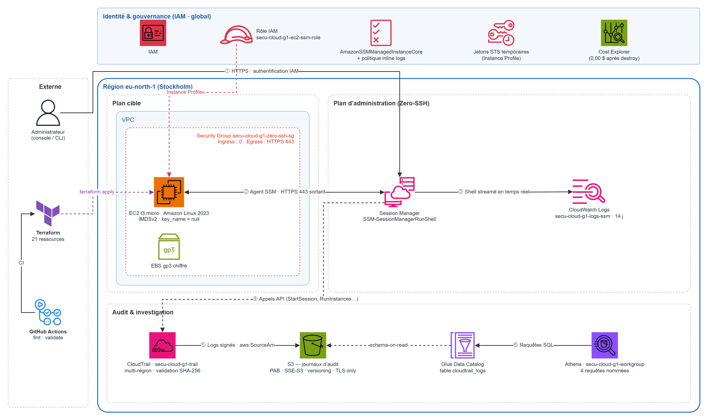

# Architecture d'Audit de Sécurité & Traçabilité AWS (Terraform)


-FF9900?logo=amazon-aws&logoColor=white)


Déploiement automatisé en **Infrastructure as Code (Terraform)** d'une architecture complète de **traçabilité (audit d'API et de sessions shell)** et d'**administration sans bastion SSH (Zero-SSH)** sur AWS.

Ce projet réalise l'industrialisation DevSecOps du **TP 1 — CloudTrail, Athena & Session Manager** dans le cadre du module *Sécurité dans le Cloud Computing* (Master 2 Système, Réseau & Cloud Computing — ESGI).

---

## 1. Architecture Déployée & Double Piste d'Audit

L'infrastructure met en œuvre **deux pistes d'audit complémentaires** pour répondre au défi majeur du **manque de visibilité** dans le cloud :
1. **Piste Control Plane (Gouvernance & API AWS) :** **AWS CloudTrail** capture tous les appels d'API du compte (console, CLI, SDK, ouverture de session SSM) et les livre dans un **bucket S3 durci**, interrogeable en SQL via **Amazon Athena**.
2. **Piste Data / OS Plane (Activité Système) :** **AWS Systems Manager (Session Manager)** remplace le protocole SSH classique (aucun port 22 ouvert, aucune clé SSH) et journalise l'intégralité des commandes tapées et de leurs sorties dans **Amazon CloudWatch Logs**.



---

## 2. Structure du Dépôt (Séparation par Responsabilité)

Le code Terraform est organisé de manière modulaire par périmètre de responsabilité :

| Fichier / Dossier | Responsabilité | Contenu technique |
| :--- | :--- | :--- |
| `providers.tf` | **Socle & Provider** | Configuration du provider AWS, tags par défaut, sources de données dynamiques (`aws_caller_identity`, `aws_region`). |
| `variables.tf` | **Paramétrage** | Variables typées avec valeurs par défaut (aucune valeur sensible ou identifiant de compte en dur). |
| `ec2.tf` | **Calcul & Défense Locale** | AMI Amazon Linux 2023 dynamique, Security Group Zero-SSH (aucun flux entrant, sortie HTTPS 443), instance EC2 durcie (IMDSv2 obligatoire, EBS chiffré, sans paire de clés). |
| `s3.tf` | **Stockage Sécurisé** | Bucket S3 dédié à CloudTrail, chiffrement au repos (SSE-S3 AES-256), versioning, `block_public_access`, `force_destroy`, et Bucket Policy restrictive (imposant TLS). |
| `iam.tf` | **Identités & Accès** | Rôle IAM et profil d'instance EC2 suivant le **moindre privilège** (`AmazonSSMManagedInstanceCore` + politique inline limitée au groupe de logs SSM). |
| `cloudtrail.tf` | **Audit API** | Trail CloudTrail multi-région, inclusion des événements globaux (IAM/STS), validation d'intégrité des fichiers de logs (`enable_log_file_validation = true`). |
| `ssm_cloudwatch.tf` | **Audit Sessions Shell** | Groupe de logs CloudWatch avec rétention définie (14 jours) et configuration automatique des préférences Session Manager (`SSM-SessionManagerRunShell`). |
| `athena.tf` | **Investigation SQL** | Base de données Glue, table externe CloudTrail (SerDe JSON), Workgroup Athena dédié et 4 requêtes nommées (`aws_athena_named_query`). |
| `queries/` | **Requêtes Threat Hunting** | Fichiers SQL d'investigation (`01_recent_events.sql`, `02_ec2_run_instances.sql`, `03_ssm_sessions.sql`, `04_access_denied.sql`). |
| `outputs.tf` | **Sorties d'exploitation** | Identifiants des ressources déployées et commande CLI prête à l'emploi pour se connecter en SSM. |
| `ANALYSE_SECURITE.md` | **Livrable Conceptuel** | Positionnement DICT, modèle de responsabilité partagée et réponses détaillées aux 5 questions de soutenance. |

---

## 3. Correspondance entre le TP Initial et l'Implémentation Terraform

| Étape du TP Original (Console AWS) | Ressources Terraform correspondantes | Améliorations Sécurité (Hardening IaC) ajoutées |
| :--- | :--- | :--- |
| **Tâche 1 & 2 :** Création du Trail CloudTrail et du bucket S3 | `aws_cloudtrail.main` (`cloudtrail.tf`)<br>`aws_s3_bucket.cloudtrail_logs` (`s3.tf`) | • Passage en **multi-région** (`is_multi_region_trail = true`)<br>• Activation de la **validation SHA-256** des logs (`enable_log_file_validation = true`)<br>• Chiffrement S3 au repos, versioning, `block_public_access` et refus explicite du trafic HTTP non chiffré (`DenyInsecureTransport`). |
| **Tâche 3 :** Consultation des journaux dans S3 | `aws_s3_bucket_policy.cloudtrail_logs` (`s3.tf`) | • Condition stricte `aws:SourceArn` sur la Bucket Policy pour éviter les attaques de type *Confused Deputy*. |
| **Tâche 4 :** Déploiement de l'instance EC2 sans clé SSH avec profil IAM | `aws_instance.audit_target` (`ec2.tf`)<br>`aws_security_group.ec2_zero_ssh` (`ec2.tf`)<br>`aws_iam_role.ec2_ssm` (`iam.tf`) | • **Remplacement de `AmazonEC2RoleforSSM`** (dépréciée et trop permissive) par **`AmazonSSMManagedInstanceCore`**.<br>• Security Group dédié avec **0 port entrant** et sortie limitée au port **443 (HTTPS)**.<br>• **IMDSv2 obligatoire** (`http_tokens = "required"`) et disque EBS chiffré. |
| **Tâche 5 :** Interrogation des journaux avec Amazon Athena | `aws_glue_catalog_database.cloudtrail` (`athena.tf`)<br>`aws_glue_catalog_table.cloudtrail_logs` (`athena.tf`)<br>`aws_athena_workgroup.audit` (`athena.tf`)<br>`aws_athena_named_query.*` (`athena.tf`) | • Création automatisée du schéma SerDe CloudTrail sans erreur manuelle de chemin `LOCATION`.<br>• Workgroup Athena isolé avec stockage chiffré des résultats et **4 requêtes SQL pré-enregistrées**. |
| **Tâche 6 & 7 :** Groupe de logs CloudWatch & Préférences Session Manager | `aws_cloudwatch_log_group.ssm_sessions` (`ssm_cloudwatch.tf`)<br>`aws_ssm_document.session_manager_prefs` (`ssm_cloudwatch.tf`) | • **Rétention définie à 14 jours** (évite la conservation infinie par défaut et maîtrise les coûts).<br>• Politique IAM inline limitant l'écriture au seul ARN du groupe de logs SSM. |
| **Tâche 8 & 9 :** Ouverture/fermeture de session SSM et lecture des logs | Output `ssm_connect_command` (`outputs.tf`) | • Commande CLI générée dynamiquement dans les outputs Terraform. |
| **Tâche 10 :** Suppression complète des ressources dans l'ordre | `terraform destroy` (`force_destroy = true` + `depends_on`) | • Vidage et suppression automatiques du bucket S3 et du Workgroup Athena sans aucune action manuelle ni ressource orpheline. |

---

## 4. Guide de Déploiement et de Démonstration

### Prérequis
* **Terraform** $\ge 1.5$ et **AWS CLI v2** configurés (`aws sts get-caller-identity`).
* Optionnel (pour la connexion SSM en terminal local) : *AWS Session Manager Plugin*.

### Étape 1 — Initialisation et Déploiement (`apply`)
```bash
terraform init
terraform validate
terraform apply -auto-approve
```

### Étape 2 — Test d'Administration Zero-SSH via Session Manager
1. Vérifier qu'aucun port entrant (notamment SSH 22) n'est ouvert et qu'aucune clé SSH n'existe.
2. Se connecter à l'instance EC2 via la console AWS (*EC2 > Connect > Session Manager*) ou directement en CLI avec la commande fournie par Terraform :
   ```bash
   $(terraform output -raw ssm_connect_command)
   ```
3. Exécuter quelques commandes de test dans la session :
   ```bash
   whoami
   hostname
   cat /etc/os-release
   echo "Audit session Groupe 1"
   exit
   ```
4. Consulter les commandes enregistrées dans **CloudWatch Logs** :
   ```bash
   aws logs tail $(terraform output -raw ssm_cloudwatch_log_group) --since 15m
   ```

### Étape 3 — Investigation des Logs d'API avec Amazon Athena
1. Vérifier en temps réel l'enregistrement de l'événement `RunInstances` ou `StartSession` via CloudTrail :
   ```bash
   aws cloudtrail lookup-events --lookup-attributes AttributeKey=EventName,AttributeValue=RunInstances --max-results 5
   ```
2. Dans la console **Amazon Athena** :
   * Sélectionner le Workgroup : **`secu-cloud-g1-workgroup`**.
   * Ouvrir l'onglet **Saved queries** (Requêtes enregistrées) et exécuter :
     * `01-derniers-evenements-api`
     * `02-creation-instance-ec2`
     * `03-audit-sessions-ssm`
     * `04-tentatives-acces-refuses`
   *(Note : CloudTrail livre ses fichiers `.json.gz` dans S3 toutes les 5 à 15 minutes).*

### Étape 4 — Destruction Propre de Bout en Bout (`destroy`)
```bash
terraform destroy -auto-approve
```
Toutes les ressources (y compris le bucket S3 contenant les logs et les résultats Athena) sont supprimées automatiquement sans résidu facturé.

---

## 5. Analyse de Sécurité & Questions de Soutenance
Consultez le document dédié **[ANALYSE_SECURITE.md](./ANALYSE_SECURITE.md)** pour l'analyse complète du modèle **DICT**, du **modèle de responsabilité partagée AWS** et les réponses détaillées aux questions du jury.
